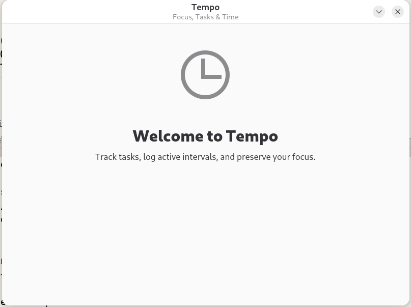

# Tempo

A lightweight, native Linux desktop application designed to help you organize your daily work rhythm, log focused time intervals, and capture quick thoughts before switching tasks.



Built in C using **GTK4**, **Libadwaita**, and **SQLite3**, adhering strictly to modern **freedesktop.org** desktop standards.

### Key Features (In Development)
* **Focus Stopwatch:** One-click task-linked timers to track work sessions accurately.
* **Context Scratchpad:** Low-friction note capture for transient thoughts, next steps, and draft logs.
* **Weekly Insights:** Simple aggregations of your total logged focus hours.
* **Native Desktop Integration:** Follows GNOME Human Interface Guidelines (HIG) with responsive dark/light styling.

---

## Building from Source

Tempo uses the [Meson](https://mesonbuild.com/) build system.

### 1. Prerequisites (Debian / Ubuntu)
Before compiling, ensure you have the required development packages installed on your system:
```bash
sudo apt update
sudo apt install meson ninja-build libgtk-4-dev libadwaita-1-dev libsqlite3-dev
```

### 2. Compile and Run
Clone the repository and run the following commands:
```Bash
git clone https://github.com/Srourrzan/tempo.git
cd tempo

# Configure the build directory (Run this only once)
meson setup build

# Compile the code
meson compile -C build

# Run the app!
./build/src/tempo
```
